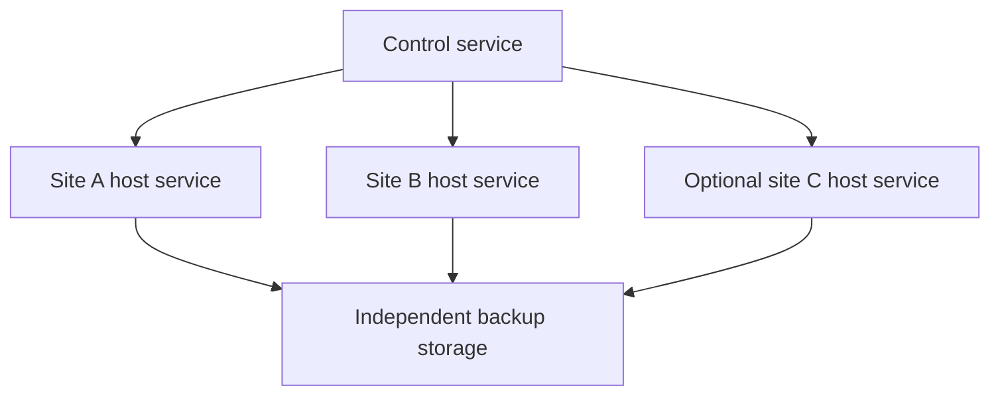

# Product architecture

[Русский](../ru/architecture.md)

## Current implementation

Version 0.1 provides the authenticated panel, host enrollment and the bundled demo recovery package. The 0.2 candidate adds self-contained Docker Compose discovery, REST/S3 connection, encrypted service bundles, exact isolated restore, independent schedules and a source-online controlled move. Its runtime acceptance is separate from this architecture description. Read the [Compose guide](compose-services.md) and [current behavior contract](../../control/contracts/compose-v2.md).

Sections 2–20 describe target profiles and integrations. PostgreSQL replication, Patroni/etcd, host certificates, provider fencing, automatic DNS changes and automatic failover are future work. The current Compose contract defines implemented API states and limits.

## 1 Scope

RolyPolyOps is intended to restore an entire service onto a compatible site and to switch service delivery to a prepared standby when policy permits. A service includes its database, persistent files, configuration, application version, required secrets, and external dependencies.

The first target environment is Linux with PostgreSQL and containerized applications. Other databases, mail systems, virtual machines, and Kubernetes require separate service packages. This specification does not claim those integrations are available.

## 2 Protection profiles

| Profile | Topology | Behavior and limits |
|---|---|---|
| single | One application site and external backup storage | Recovery requires a replacement target and restore time |
| pair_assisted | Primary, prepared standby, and external storage | An operator confirms switching after source fencing |
| pair_automatic | Two data sites with tested external fencing | Requires reachable decision authority and a validated provider adapter |
| cluster | At least three data nodes and a three-member or larger odd etcd quorum | Role changes depend on quorum, replica eligibility, and source protection |

Count data nodes, voting members, and backup repositories separately. Multiple machines in one failure domain are not independent sites. Three data nodes are required for continued strict synchronous writes after one data-node loss in the baseline PostgreSQL profile; a witness without data does not replace the third data node.

## 3 System boundaries

The control service stores policies and operation history. A host service performs scoped actions on each server. Data moves directly between the source and its storage targets, without passing through the control panel.

Database role authority and public traffic routing are separate. A DNS update cannot promote a database or fence an old primary.

## 4 Data protection components

PostgreSQL supplies database replication. pgBackRest supplies database backups and WAL archiving. restic supplies encrypted file and configuration backups. Patroni and etcd provide the cluster role authority. HAProxy may provide access to the authorized primary. Stable file generations can be transferred with rsync; Garage is an optional quorum-based object-storage profile.

These component roles are target integrations, not completed features. Exact supported versions and deployment combinations must be listed with each available product version. External licenses remain separate.

## 5 Control service availability

The control catalog is separate from protected application databases. The initial topology has one active control writer. It must not use a shared SQLite file with several independent writers.

Previously authorized local backup schedules continue if the control service is unavailable. New destructive actions and policy changes stop. A replacement control service must exclude the old authority, advance its authority epoch, and prevent acceptance of stale commands. Cluster database authority continues to belong to Patroni and etcd.

## 6 Service and recovery records

A server record contains a persistent ID, failure domain, roles, capacity, and fencing capabilities. A service record identifies the application package, current version, data sets, authorized targets, and desired policy.

A recovery point links database backup identity, the required WAL range, file snapshot identity, configuration hash, application image digest, and service-package version. Repository transfer and verification results are stored separately for each required location. The control catalog stores references to secrets, not plaintext secret values.

## 7 Host identity and privileges

Enrollment uses a single-use token followed by a distinct host certificate. Host identity is bound to a persistent ID rather than an IP address alone. The host service uses outbound authenticated connections and a restricted privileged helper where administrative operations are necessary.

Commands contain an operation ID, target, plan hash, expected revision, policy revision, authority epoch, and expiry. A host rejects expired or stale authority, a mismatched target, and replayed completed mutations. Arbitrary shell input is not a supported control API.

## 8 Operation states and retries

Only one operation may mutate a service's data, primary role, or profile at a time. Requests have idempotency keys. A repeated request returns the existing operation instead of executing another copy.

Operation states are planned, validating, awaiting_confirmation, running, succeeded, failed, cancelled, and outcome_unknown. If an external action might have completed but its reply was lost, its actual state must be reconciled before retrying. Cancellation does not undo already committed irreversible changes. Confirmation binds to the exact plan and revision.

## 9 Service packages

A service package defines persistent data, application version, dependencies, secret references, write-quiescing behavior, consistency capture, recovery, and useful application checks. Each action has a timeout, retry rules, and safe stop conditions.

Packages are trusted executable integrations. A generic container restart is not proof that a database, attachment, or customer workflow was restored. Unsupported applications must not be presented as supported solely because their containers can start.

## 10 Consistent recovery points

A database reference to an attachment must resolve to the matching restored file. Independent successful database and file backups do not establish that relationship.

The basic capture sequence is: block all new writes, drain in-flight work, create a database restore point and stable file snapshot, record application/configuration identity, resume writes after stable inputs exist, transfer the inputs, and verify the full recovery chain before publishing the point.

Without a file-system snapshot or immutable object versions, quiescing may last through staging the files. Full-service point-in-time recovery is limited to times for which matching files are confirmed, even when database WAL permits finer recovery.

## 11 Backup placement and retention

One independent external repository is valid; additional locations strengthen history availability. Each required location has its own transfer and integrity state. A point is not fully protected when the policy requires two repositories and only one is complete.

Backup engines use separate prefixes and the service manifest links their records. Cleanup retains all dependent backup chains, WAL, file generations, and package versions. Source material is not removed before required transfers finish. Replicating deletions does not create protected history.

The baseline storage method is independent encrypted copies. Product-owned erasure coding is not required. A repository outage must expose backlog and source capacity risk rather than silently discard required journals.

## 12 Replication and file generations

The assisted pair defaults to asynchronous PostgreSQL replication. Lag is measured and stale observations become unknown. A standby database rejects application writes.

Files are copied from stable inputs into a new standby generation. An incomplete generation is never activated. If a current database replica refers to missing files, the standby is not ready for full-service failover. A safe fallback is restoring the last complete service point, with an explicit data-loss boundary.

Garage may provide an optional three-copy object-storage profile across failure domains. Consistency and disk synchronization settings must be explicit. It does not make database and object updates one transaction and does not replace external backup history.

## 13 Pair failover

The switching sequence is: lock the operation, validate target data, fence the previous primary, reconcile target state, promote or restore the selected database, start the correct application version, validate useful behavior, then change traffic routing and verify the public address.

Fencing must remain effective until the old site is safely returned as a standby. An unreachable network endpoint or DNS removal is not fencing. If fencing cannot be established, promotion stops. Automatic pair switching requires an explicitly permitted, tested provider-specific profile and a reachable decision executor.

Divergent old-primary data is preserved for examination. No blind merge of diverged databases is attempted.

## 14 Cluster failover

Patroni and etcd own the primary role. The strict baseline enables synchronous mode and synchronous_mode_strict with one required synchronous standby and synchronous_commit enabled. Three data nodes allow continued strict writes after a single data-node loss, subject to the actual failure and eligible replicas.

An appropriate watchdog and, where required, external fencing protect the old primary. Missing quorum or an eligible replica may stop writes. No automatic downgrade to unsafe commit settings is permitted. The panel, host services, and DNS adapters must not elect another primary independently.

Strict replication is not an unconditional zero-loss guarantee for every failure combination. Public routing follows validated application readiness, with DNS caching and existing connections included in recovery measurements.

## 15 Restore behavior

A restore selects the service, recovery point, source repository, and target. An isolated target is the default. The plan shows data age, package and image identity, required keys, capacity, and external effects.

Preflight checks compatibility, capacity, keys, and the recovery chain. Data is restored into new locations, the application starts in isolation, and useful checks run. Replacing a live service is a separate transition with a write boundary and explicit authorization.

After new writes on a replacement primary, returning to the old database is not a simple rollback. The old site must first be reconciled and rejoined as a standby. A historical restore may be used to extract selected data without replacing the live service.

## 16 Verification levels

Transfer completion, archive integrity, data restoration, useful application checks, and failure exercises are separate results. A checksum does not prove that an application can start; a successful startup does not prove every user workflow.

Restore drills record the recovery point, package version, exact checks, duration, and limits. They run with restricted credentials and outbound restrictions so restored workers cannot trigger real payments or notifications. Missing or stale evidence is visible and cannot be represented as a successful current drill.

## 17 Profile changes

Adding a server produces a proposal, not immediate authorization for more automation. A single-to-pair transition requires a verified copy, prepared standby, synchronization, and a switch exercise. Pair-to-cluster requires the data replicas, quorum, role protection, and tested failure behavior.

Profile reduction changes authority and guarantees and therefore requires an explicit plan. Losing a server marks protection as degraded; it does not approve a weaker policy. Interrupted transitions have durable state and cannot leave competing database-role controllers active.

## 18 Security and backup keys

Application, backup writer, restore checker, and retention administrator have separate rights. Application hosts must not permanently hold credentials that can erase all retained history. Encryption keys and an emergency recovery kit remain available outside the source and control catalog.

Immutable storage, versioning, and append-only modes require tested compatibility with backup engines and cleanup. A blanket object-deletion denial is not assumed to work with every repository. Full compromise of administrative authority remains a serious residual risk.

## 19 User operations and API

The panel presents service location, independent copy count, last complete point, replica lag, last restore drill, and violated policies. Users act on services and recovery points rather than low-level engine commands.

The proposed API exposes service state, protection state, operation planning, execution, status, and cancellation. Mutations carry expected revisions and idempotency keys. A changed plan invalidates prior confirmation. The [shared control API](../../control/API.md) covers identity, the queue and the original demo profile. The [Compose contract](../../control/contracts/compose-v2.md) defines the 0.2 candidate service/storage API. The replication and automatic switching profiles in this document remain targets.

## 20 Observability and recovery objectives

Measure recovery-point age, database and file lag, WAL continuity, free capacity, transfer backlog, certificate validity, and last successful drill. Group repeated unchanged alerts while notifying on actionable failures and required decisions.

RPO and RTO targets are policy inputs. Actual available-data age and measured recovery duration are observations. Recovery time includes detection, operator response where applicable, transfers, image availability, routing changes, and external application checks. No fixed time or storage-saving ratio is guaranteed before measurement.

## 21 Compatibility and current limits

Version 0.1.0 adds an authenticated bilingual control panel, outgoing host services, a persistent operation queue, connection/setup wizard, and backup/restore controls for the bundled demo package. The lab remains separately versioned. The 0.2 candidate implements bounded Compose discovery and backup/restore through its own wizard. Replication, provider fencing, automatic DNS changes and cluster operation remain unimplemented. A valid manifest is not evidence that a target can safely run it. See the [control guide](../../control/README.md).

Actual application versions, volumes, provider APIs, network latency, disk behavior, key access, and failure domains must be established for each supported deployment. One-site failure is the baseline cluster scenario; arbitrary simultaneous failures are outside that claim. See [compatibility](compatibility.md) and [technical references](references.md).
