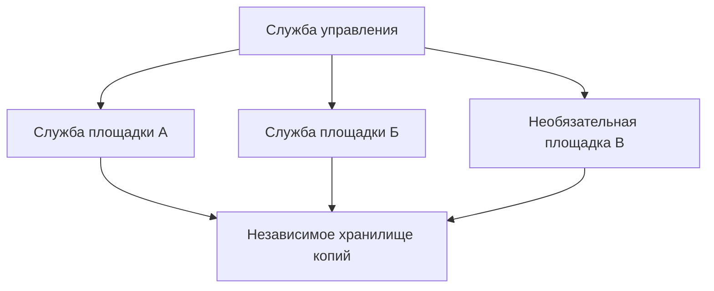

# Архитектура продукта

[English](../en/architecture.md)

## Текущая реализация

Версия 0.1 предоставляет защищенную панель, подключение серверов и восстановление исходного тестового приложения. Кандидат 0.2 добавляет обнаружение самодостаточных проектов Docker Compose, подключение REST/S3, зашифрованный набор сервиса, восстановление точной копии в изоляции, отдельные расписания и управляемый перенос при доступном источнике. Проверка работы выполняется отдельно от описания архитектуры. См. [руководство Compose](compose-services.md) и [контракт текущего поведения](../../control/contracts/compose-v2.ru.md).

Разделы 2–20 описывают целевые профили и подключения. Репликация PostgreSQL, Patroni/etcd, сертификаты серверов, внешнее отключение площадок, автоматическое изменение DNS и автоматическое переключение относятся к будущей работе. Реальные состояния API и ограничения Compose определяет текущий контракт.

## 1 Назначение

RolyPolyOps предназначен для восстановления сервиса целиком на совместимой площадке и переключения обслуживания на подготовленный резерв, когда это допускает политика. В сервис входят база, постоянные файлы, конфигурация, версия приложения, необходимые секреты и внешние зависимости.

Первая целевая среда: Linux, PostgreSQL и приложения в контейнерах. Другие базы, почтовые системы, виртуальные машины и Kubernetes требуют отдельных пакетов поддержки. Наличие этих подключений не заявляется.

## 2 Профили защиты

| Профиль | Состав | Поведение и ограничения |
|---|---|---|
| single | Одна площадка приложения и внешнее хранилище копий | Нужны новая цель и время восстановления |
| pair_assisted | Основная площадка, подготовленный резерв и внешнее хранилище | Оператор подтверждает переключение после блокировки источника |
| pair_automatic | Две площадки с данными и проверенное внешнее отключение | Нужны доступный исполнитель решения и проверенное подключение к хостеру |
| cluster | Не менее трех узлов данных и нечетное большинство etcd из трех и более участников | Смена роли зависит от большинства, пригодности реплики и защиты источника |

Узлы данных, участники голосования и хранилища копий считаются отдельно. Несколько машин в одной области отказа не являются независимыми площадками. Для продолжения строгой синхронной записи после потери одного узла в базовом профиле PostgreSQL нужны три узла с данными; участник голосования без данных третий узел не заменяет.

## 3 Границы системы

Служба управления хранит политики и историю операций. На каждом сервере служба сервера выполняет ограниченный набор действий. Данные передаются между источником и местами хранения напрямую, без пересылки через панель.

Полномочия основной базы и внешний маршрут пользователей разделены. Изменение DNS не назначает основную базу и не блокирует прежний основной сервер.

## 4 Компоненты защиты данных

PostgreSQL обеспечивает репликацию базы. pgBackRest отвечает за ее копии и архивирование журналов WAL. restic сохраняет зашифрованные копии файлов и конфигурации. Patroni и etcd управляют основной ролью кластера. HAProxy может предоставлять доступ к разрешенной основной базе. Стабильные поколения файлов можно передавать через rsync; Garage является дополнительным профилем объектного хранилища с большинством.

Это назначение предполагаемых подключений, а не перечень завершенных функций. Поддерживаемые версии и сочетания размещения должны указываться для каждой доступной версии продукта. Лицензии внешних компонентов учитываются отдельно.

## 5 Доступность управления

Каталог управления отделен от баз защищаемых приложений. Начальная топология имеет один активный источник изменения каталога. Нельзя открывать общий файл SQLite несколькими независимыми писателями.

При потере управления ранее разрешенные местные расписания копирования продолжаются. Новые опасные действия и изменения политики приостанавливаются. Заменяющая служба управления должна исключить прежние полномочия, увеличить номер их поколения и запретить устаревшие команды. Полномочия базы в кластере остаются у Patroni и etcd.

## 6 Сервис и записи восстановления

Запись сервера содержит постоянный идентификатор, область отказа, роли, ресурсы и возможности блокировки. Запись сервиса определяет пакет приложения, текущую версию, состав данных, разрешенные цели и требуемую политику.

Точка восстановления связывает копию базы, необходимый диапазон WAL, снимок файлов, хеш конфигурации, хеш образа приложения и версию пакета поддержки. Передача и проверки учитываются отдельно для каждого обязательного места хранения. Каталог управления хранит ссылки на секреты, а не их открытые значения.

## 7 Идентичность сервера и права

Для регистрации используется одноразовый код, после него выдается отдельный сертификат сервера. Идентичность привязана к постоянному идентификатору, а не только к IP-адресу. Служба сервера использует исходящие защищенные соединения и ограниченный привилегированный помощник для необходимых административных действий.

Команда содержит идентификатор операции, цель, хеш плана, ожидаемую ревизию, ревизию политики, поколение полномочий и срок действия. Сервер отвергает просроченные или устаревшие полномочия, чужую цель и повтор завершенного изменения. Произвольная строка командной оболочки не является поддерживаемым API управления.

## 8 Состояния операций и повторы

Одновременно данные сервиса, основную роль или профиль меняет только одна операция. Запросы имеют ключ повторяемости. Повтор запроса возвращает существующую операцию вместо еще одного выполнения.

Состояния операции: planned, validating, awaiting_confirmation, running, succeeded, failed, cancelled и outcome_unknown. Если внешнее действие могло завершиться, но ответ потерян, перед повтором проверяется фактическое состояние. Отмена не возвращает уже выполненные необратимые изменения. Подтверждение связано с точным планом и ревизией.

## 9 Пакеты поддержки сервиса

Пакет поддержки определяет постоянные данные, версию приложения, зависимости, ссылки на секреты, остановку записи, получение согласованного состояния, восстановление и проверку полезной функции. Для каждого действия заданы срок выполнения, правила повторения и условия безопасной остановки.

Пакеты являются доверенными исполняемыми подключениями. Обычный перезапуск контейнера не доказывает восстановление базы, вложения или пользовательского действия. Приложение нельзя объявлять поддерживаемым только потому, что его контейнер запускается.

## 10 Согласованные точки восстановления

Ссылка базы на вложение должна вести к соответствующему восстановленному файлу. Отдельно успешные копии базы и файлов такой связи не доказывают.

Базовый порядок: заблокировать новые изменения по всем путям, дождаться начатых операций, создать точку базы и стабильный снимок файлов, записать версию приложения и конфигурации, возобновить запись после получения стабильных исходных данных, передать данные и проверить полную цепочку перед публикацией точки.

Без снимка файловой системы или неизменяемых версий объектов остановка записи может продолжаться до окончания копирования файлов в промежуточную область. Восстановление всего сервиса на момент времени ограничено подтвержденным наличием соответствующих файлов, даже когда WAL допускает более точное восстановление базы.

## 11 Размещение копий и сроки хранения

Одно независимое внешнее хранилище допустимо; дополнительные места повышают доступность истории. Для каждого обязательного места отдельно учитываются передача и целостность. Точка не получает полную защиту, если политика требует два хранилища, а завершено одно.

Движки используют отдельные префиксы, их записи связывает манифест сервиса. Очистка сохраняет необходимые цепочки копий, WAL, поколения файлов и версии пакетов. Исходные материалы не удаляются до окончания обязательной передачи. Репликация удалений не создает защищенную историю.

Основной способ хранения: независимые зашифрованные копии. Собственное избыточное кодирование продукта не требуется. При отказе хранилища должны быть видны очередь и риск заполнения источника; необходимые журналы нельзя удалять молча.

## 12 Репликация и поколения файлов

В паре с подтверждением по умолчанию используется асинхронная репликация PostgreSQL. Отставание измеряется, устаревшее наблюдение получает статус неизвестного. Резервная база отвергает пользовательскую запись.

Файлы передаются из стабильного источника в новое поколение на резерве. Незавершенное поколение не включается. Если актуальная реплика базы ссылается на отсутствующие файлы, резерв не готов к переключению всего сервиса. Безопасный запасной вариант: последняя полная точка сервиса с явной границей потери данных.

Garage может обеспечивать дополнительный профиль из трех копий объектов в разных областях отказа. Режим согласованности и запись на диск задаются явно. Он не объединяет изменения базы и объектов в одну транзакцию и не заменяет внешнюю историю копий.

## 13 Переключение пары

Порядок переключения: заблокировать операцию, проверить данные цели, устойчиво отключить прежний основной источник, сверить состояние цели, назначить или восстановить выбранную базу, запустить нужную версию приложения, проверить полезное действие, затем изменить маршрут и проверить внешний адрес.

Блокировка действует до безопасного возврата старой площадки резервной. Недоступность по сети и исключение из DNS не являются блокировкой. Если блокировку подтвердить нельзя, назначение основной роли останавливается. Автоматическая пара требует явно разрешенного и проверенного профиля конкретного хостера и доступного исполнителя решения.

Разошедшиеся данные прежней основной базы сохраняются для разбора. Слепое слияние разошедшихся баз не выполняется.

## 14 Переключение кластера

Основной ролью управляют Patroni и etcd. Базовая строгая политика включает синхронный режим, synchronous_mode_strict, одну обязательную синхронную реплику и synchronous_commit. Три узла данных позволяют продолжать строгую запись после потери одного узла с учетом конкретного отказа и пригодности реплик.

Старую основную базу защищают подходящий watchdog и при необходимости внешнее отключение. Отсутствие большинства или пригодной реплики может остановить запись. Автоматический переход к небезопасным настройкам подтверждения запрещен. Панель, службы серверов и DNS не выбирают отдельную основную базу самостоятельно.

Строгая репликация не дает безусловной гарантии нулевых потерь при любых сочетаниях отказов. Внешний маршрут меняется после проверки готовности приложения; кеш DNS и существующие соединения учитываются при измерении восстановления.

## 15 Порядок восстановления

Для восстановления выбираются сервис, точка, исходное хранилище и цель. По умолчанию цель изолирована. План показывает возраст данных, версию пакета и образа, необходимые ключи, ресурсы и внешние последствия.

Предварительная проверка подтверждает совместимость, место, ключи и цепочку восстановления. Данные возвращаются в новые каталоги, приложение запускается в изоляции и проходит полезные проверки. Замена рабочего сервиса является отдельным переходом с границей записи и явным разрешением.

После новых записей на заменяющей основной базе возврат к прежней базе не является простым откатом. Старую площадку сначала согласуют и подключают резервной. Историческую копию можно использовать для извлечения отдельных данных без замены рабочего сервиса.

## 16 Уровни проверки

Завершение передачи, целостность архива, восстановление данных, полезные проверки приложения и испытание отказа являются отдельными результатами. Контрольная сумма не доказывает запуск приложения; успешный запуск не доказывает все пользовательские действия.

Пробное восстановление фиксирует точку, версию пакета, конкретные проверки, длительность и ограничения. Оно выполняется с ограниченными ключами и исходящими соединениями, чтобы восстановленные задания не запускали реальные платежи и уведомления. Отсутствующие или устаревшие доказательства видны и не выдаются за успешное актуальное испытание.

## 17 Изменение профиля

Добавление сервера создает предложение, а не немедленное разрешение дополнительной автоматики. Для перехода одного сервера в пару нужны проверенная копия, подготовленный резерв, синхронизация и испытание переключения. Для перехода пары в кластер нужны реплики данных, большинство, защита ролей и проверенное поведение при отказе.

Уменьшение профиля меняет полномочия и гарантии, поэтому требует явного плана. Потеря сервера означает ухудшение защиты, но не утверждение более слабой политики. Прерванный переход имеет сохраненное состояние и не оставляет конкурирующие механизмы управления ролью базы.

## 18 Безопасность и ключи копий

Приложение, исполнитель копирования, проверяющий восстановления и администратор очистки имеют отдельные права. Рабочие серверы не должны постоянно хранить ключи, позволяющие удалить всю историю. Ключи шифрования и аварийный комплект доступны вне источника и каталога управления.

Неизменяемое хранение, версии и режим добавления требуют проверенной совместимости с движками и очисткой. Полный запрет удаления объектов не считается совместимым с любым репозиторием заранее. Полный захват административных полномочий остается серьезным остаточным риском.

## 19 Пользовательские операции и API

Панель показывает размещение сервиса, число независимых копий, последнюю полную точку, отставание реплик, последнее пробное восстановление и нарушенные требования. Пользователь работает с сервисами и точками, а не с низкоуровневыми командами движков.

Предполагаемый API предоставляет состояние сервиса и защиты, планирование, выполнение, состояние и отмену операций. Изменяющие запросы содержат ожидаемую ревизию и ключ повторяемости. Измененный план аннулирует прежнее подтверждение. [Общий API управления](../../control/API.ru.md) описывает вход, очередь и исходный тестовый профиль. [Контракт Compose](../../control/contracts/compose-v2.ru.md) определяет API сервисов и хранилищ кандидата 0.2. Профили репликации и автоматического переключения из этого документа остаются целевыми.

## 20 Наблюдение и требования к восстановлению

Измеряются возраст точки, отставание базы и файлов, непрерывность WAL, свободное место, очередь передачи, срок сертификатов и последнее успешное испытание. Повторы неизменного состояния группируются, о значимых отказах и необходимых решениях сообщается.

Целевые RPO и RTO являются требованиями политики. Фактический возраст доступных данных и измеренное время восстановления являются наблюдениями. Время включает обнаружение, при необходимости реакцию оператора, передачу, доступность образов, изменение маршрута и внешние проверки приложения. Фиксированное время и экономия хранения до измерений не гарантируются.

## 21 Совместимость и текущие ограничения

Версия 0.1.0 добавляет защищенную двуязычную панель, исходящие серверные службы, постоянную очередь операций, мастер подключения и настройки, управление копированием и восстановлением тестового пакета. Версия приложения стенда учитывается отдельно. Кандидат 0.2 реализует ограниченное обнаружение Compose и копирование с восстановлением через отдельный мастер. Репликация, внешнее отключение площадки, автоматическое изменение DNS и кластер остаются нереализованными. Корректный манифест не доказывает безопасное выполнение на целевом сервере. См. [руководство управления](../../control/README.ru.md).

Для каждого поддерживаемого размещения устанавливаются реальные версии приложений, объемы, API хостеров, задержки сети, поведение диска, доступ к ключам и области отказа. Базовый сценарий кластера: потеря одной площадки; произвольные одновременные отказы этим утверждением не охватываются. См. [совместимость](compatibility.md) и [технические источники](references.md).
